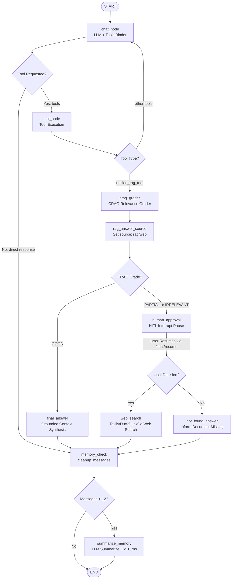
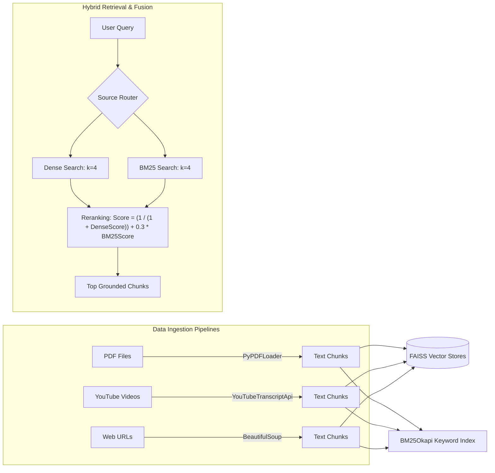
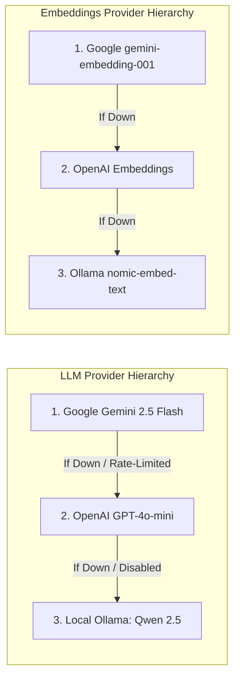
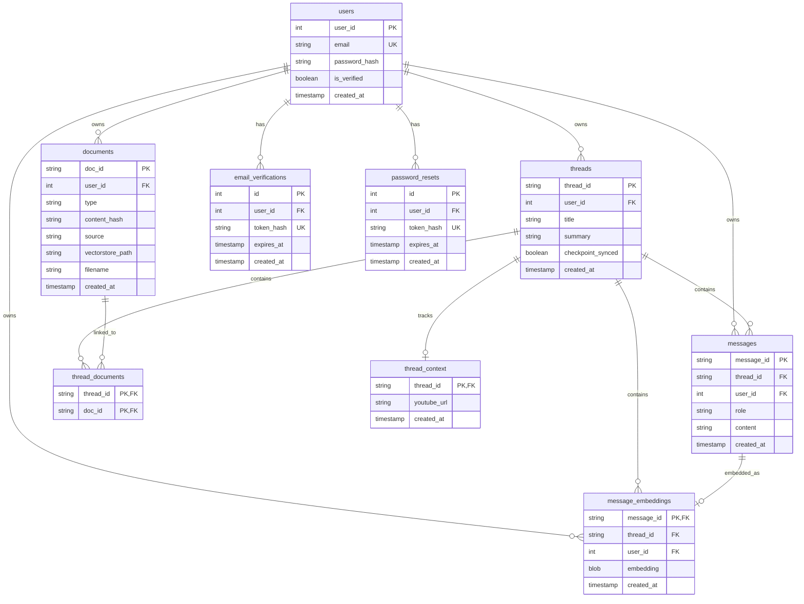

# 🤖 CortexAI — LangGraph Multi-Tool Hybrid RAG & Corrective Agent

[](https://www.python.org/)
[](https://github.com/langchain-ai/langgraph)
[](https://github.com/langchain-ai/langchain)
[](https://fastapi.tiangolo.com/)
[](https://streamlit.io/)
[](https://github.com/facebookresearch/faiss)
[](https://opensource.org/licenses/MIT)

**CortexAI** is an advanced, production-grade conversational AI platform built on **LangGraph**, **FastAPI**, and **Streamlit**. It integrates **Corrective RAG (CRAG)**, **Human-in-the-Loop (HITL) execution pauses**, **Adaptive Memory Summarization (STM)**, and **Multi-Source Hybrid RAG** (PDFs, YouTube transcripts, and live Web URLs). The agent is backed by a resilient **multi-tier LLM fallback chain** (Gemini $\to$ OpenAI $\to$ Ollama), persistent **SQLite checkpointing**, and secure **JWT authentication** with email verification.

---

## 📑 Table of Contents

- [🌟 What's New in this Version](#-whats-new-in-this-version)
- [✨ Key Features](#-key-features)
- [🏗️ System Architecture](#️-system-architecture)
  - [LangGraph Agent Execution Flow](#langgraph-agent-execution-flow)
  - [Node Responsibilities & State Routing](#node-responsibilities--state-routing)
- [🔍 Corrective RAG (CRAG) & HITL Engine](#-corrective-rag-crag--hitl-engine)
- [📚 Multi-Source Hybrid RAG Subsystem](#-multi-source-hybrid-rag-subsystem)
- [🧠 Adaptive Memory & STM Summarization](#-adaptive-memory--stm-summarization)
- [🛠️ Multi-Tool Agent Suite](#️-multi-tool-agent-suite)
- [🔄 Resilient LLM & Embedding Fallbacks](#-resilient-llm--embedding-fallbacks)
- [📁 Directory Structure](#-directory-structure)
- [💻 Tech Stack](#-tech-stack)
- [🚀 Getting Started](#-getting-started)
  - [Prerequisites](#prerequisites)
  - [Installation](#installation)
  - [Configuration (`.env`)](#configuration-env)
- [⚡ Running the Application](#-running-the-application)
- [📡 API Documentation](#-api-documentation)
- [🖥️ Frontend Walkthrough & HITL UI](#️-frontend-walkthrough--hitl-ui)
- [🗄️ Database Schema](#️-database-schema)
- [🤝 Contributing & License](#-contributing--license)

---

## 🌟 What's New in this Version

- 🎯 **Corrective RAG (CRAG) Relevance Grader**: Evaluates retrieved chunks as `GOOD`, `PARTIAL`, or `IRRELEVANT` prior to generation, eliminating hallucinations and irrelevant context.
- ⏸️ **Human-in-the-Loop (HITL) Interruption**: Utilizes `langgraph.types.interrupt` to pause workflow execution when document context is insufficient, asking the user whether to perform a live web search.
- 🌐 **Web URL Ingestion**: Real-time website scraper (`BeautifulSoup` + `lxml`) that cleans DOM trees, extracts core article text, and indexes web content into dedicated FAISS vector stores without arbitrary truncation.
- 🧹 **Internal Message Cleanup**: Automatically cleans up intermediate `ToolMessage`, tool-call metadata, and internal nodes before checkpointing, keeping persisted user history clean.
- 🧠 **Adaptive Short-Term Memory (STM) Summarization**: Automatically condenses conversation history into `state["summary"]` when turn counts exceed configurable thresholds, retaining only recent active turns.
- 🔁 **Dedicated HITL Resumption Endpoint (`/chat/resume`)**: Resumes paused graph checkpoints via LangGraph `Command(resume=decision)`.
- 📊 **Reciprocal Rank Fusion (RRF) & Multi-Doc Balance**: Upgraded hybrid RAG scoring with mathematically sound RRF ($k=60$), stopword-aware BM25 tokenization, content deduplication, and balanced chunk allocation across multiple attached documents.
- 📑 **1-Indexed Citations & Grounding Prompts**: Enforces structured answers grounded in document context with explicit citations (`[Document: ..., Page: ...]`) and expandable source citations in the Streamlit frontend.

---

## ✨ Key Features

- 🧠 **LangGraph Cyclical State Graph**: Robust state machine supporting tool execution loops, conditional branching, interrupts, and resumable execution.
- 📄 **Multi-Source Hybrid RAG**:
  - Ingestion for **PDF Documents**, **YouTube Transcripts**, and **Live Web URLs**.
  - **Dense Search (FAISS)** + **Sparse Keyword Search (BM25Okapi)** with weighted score fusion and deduplication.
  - SHA-256 content hashing to avoid redundant vectorization across threads and users.
- 🛡️ **Zero-Hallucination Guardrails**:
  - CRAG verifies retrieved chunk relevance against the user's specific query.
  - Final answers are synthesized strictly from grounded context with source citations.
- 🛠️ **Extensible Multi-Tool Agent**:
  - `unified_rag_tool`: Multi-source document and video grounding.
  - `search_tool`: Live internet search (Tavily Search + DuckDuckGo failover with LRU caching).
  - `get_stock_price`: Real-time stock performance and quotes via Alpha Vantage.
  - `python_executor`: Sandboxed code execution with standard output capture.
  - `calculator`: Zero-division protected arithmetic engine.
- 🔄 **Self-Healing LLM & Embedding Fallbacks**:
  - Primary: Google Gemini (`gemini-2.5-flash` / `gemini-embedding-001`)
  - Secondary: OpenAI (`gpt-4o-mini` / `text-embedding-ada-002`)
  - Offline / Local: Ollama (`qwen2.5:3b` / `nomic-embed-text`)
- 🔐 **Full-Featured Authentication**:
  - Bcrypt password hashing, JWT Bearer tokens, and user profile management.
  - Automated verification emails and password reset links via SMTP (**FastAPI-Mail**).
- 💾 **Persistent SQLite Memory**:
  - Turn-by-turn conversation checkpointing via `SqliteSaver`.
  - Automatic chat title generation triggered on first prompt.
- 🖥️ **Split-Screen Interactive Frontend (Streamlit)**:
  - Dual-pane layout: Live chat interface on one side; embedded PDF viewer and YouTube player on the other.
  - Integrated HITL approval modal with interactive "Search the web" / "Don't search" action buttons.

---

## 🏗️ System Architecture

### LangGraph Agent Execution Flow



### Node Responsibilities & State Routing

| Node Name | Module | Responsibility |
| :--- | :--- | :--- |
| **`chat_node`** | `app/graph/nodes.py` | Determines user intent, incorporates document metadata & thread summary, and invokes LLM with tool bindings. |
| **`tools`** | `app/graph/tool_node.py` | Executes the requested tool (`unified_rag_tool`, `search_tool`, `get_stock_price`, etc.). |
| **`crag_grader`** | `app/graph/crag_grader.py` | Evaluates retrieved chunk relevance and assigns `GOOD`, `PARTIAL`, or `IRRELEVANT`. |
| **`rag_answer_source`** | `app/graph/agent_graph.py` | Sets `answer_source` attribute to `rag` or `web`. |
| **`human_approval`** | `app/graph/hitl.py` | Triggers `interrupt()` to halt execution and seek user permission to query the live web. |
| **`web_search`** | `app/graph/web_serach.py` | Strips prompt artifacts, searches the web, and formats structured results with URLs. |
| **`not_found_answer`** | `app/graph/not_found.py` | Polite fallback response when documents lack information and web search is declined. |
| **`final_answer`** | `app/graph/fin_ans.py` | Generates a grounded final answer using the verified retrieved context. |
| **`memory_check`** | `app/graph/message_cleanup.py` | Strips internal `ToolMessage` and execution artifacts from conversation history. |
| **`summarize_memory`** | `app/memory/stm.py` | Compresses older messages into `summary` when history exceeds 12 turns, keeping recent 6 messages active. |

---

## 🔍 Corrective RAG (CRAG) & HITL Engine

```
User Query: "What are the project deliverables mentioned in the uploaded file?"
                   │
                   ▼
         [unified_rag_tool]
                   │  (Retrieves Chunks from FAISS + BM25)
                   ▼
         [crag_relevance_grader]
          Does context answer the query?
          ├── GOOD ───────► [final_answer] ──► Accurate Answer
          └── IRRELEVANT ──► [human_approval] (INTERRUPT)
                                   │
              ┌────────────────────┴────────────────────┐
              ▼                                         ▼
      User Selects "Yes"                        User Selects "No"
              │                                         │
        [web_search]                            [not_found_answer]
              │                                         │
     Live Web Results                          "Information not found in
     with Sources & Links                       uploaded documents."
```

When an interrupt fires, the backend returns:
```json
{
  "status": "human-approval",
  "thread_id": "84b1f41d-...",
  "interrupt": {
    "type": "human_approval",
    "message": "I couldn't find enough information to answer this question from your uploaded documents.",
    "question": "What is the capital of Australia?",
    "rag_grade": "IRRELEVANT",
    "options": {
      "yes": "Search the web",
      "no": "Don't search the web"
    }
  }
}
```

The frontend renders action buttons, and clicking an option invokes `POST /chat/resume` to seamlessly resume the execution graph.

---

## 📚 Multi-Source Hybrid RAG Subsystem

CortexAI indexes and queries three heterogeneous knowledge formats within the same unified retrieval pipeline:



### Ingestion Details
- **PDF Documents** (`app/services/pdf_ingest.py`): Chunked via `RecursiveCharacterTextSplitter` (size: 1000, overlap: 200). Content-hashed to prevent redundant embedding generation.
- **YouTube Transcripts** (`app/services/youtube_ingest.py`): Extracts transcript text via video ID, chunks text, and builds dedicated FAISS vector index.
- **Web Pages** (`app/services/web_loader.py` & `app/core/web_processor.py`): Fetches web content, strips scripts/navigation/styles, isolates article body, and indexes into FAISS.

---

## 🧠 Adaptive Memory & STM Summarization

Long-running conversations often exceed LLM context windows or inflate token costs. CortexAI solves this with an **Adaptive Short-Term Memory (STM)** subsystem:

1. **Threshold Trigger**: After each turn, `should_summarize` checks total message count. If message count $> 12$, summarization is initiated.
2. **Selective Filtering**: Internal tool calls, tool responses, and system prompts are filtered out using `is_conversation_message()`.
3. **Progressive Summary Generation**: Older messages are passed to the LLM along with `MEMORY_UPDATE_PROMPT` to produce a concise summary saved in `state["summary"]`.
4. **Active Window Retention**: Only the last **6 real conversation messages** (User and AI turns) remain in active state; older messages are pruned with LangGraph `RemoveMessage`.

### 🔍 Hybrid Historical Conversation Memory Retrieval

When a user asks questions about earlier discussions in a thread, CortexAI uses hybrid search over the durable SQLite message store:

- **Dual-Engine Search**: Combines **Dense Semantic Search** (via embeddings cosine similarity) and **Sparse BM25 Search** (`rank_bm25` BM25Okapi) over candidate historical messages.
- **Incremental Embedding Cache**: Message embeddings are cached in the SQLite `message_embeddings` table to eliminate duplicate API calls.
- **Reciprocal Rank Fusion (RRF)**: Ranks candidate messages using $RRF(d) = \sum_{m} \frac{1}{K + \text{rank}_m(d)}$ with configurable $K=60$.
- **Strict Isolation**: Retrieval is strictly parameterized and scoped by `thread_id` and authenticated `user_id`.
- **Deduplication & Safety**: Messages already present in the active recent window are never duplicated. Retrieved historical context is wrapped in an explicit untrusted boundary delimiter to prevent prompt injection.
- **Graceful Fallbacks**: If the embedding provider fails, it seamlessly falls back to BM25 keyword matching; if BM25 fails, it falls back to semantic search; if both fail, the turn proceeds normally with summary and recent messages without crashing.

---

## 🛠️ Multi-Tool Agent Suite

| Tool Name | Source File | Description | Fallback Mechanism |
| :--- | :--- | :--- | :--- |
| **`unified_rag_tool`** | `app/tools/unified_rag_tool.py` | Answers queries grounded in uploaded PDFs, YouTube transcripts, or web URLs linked to the current thread. | Heuristic source router (`pdf` / `youtube` / `web`) + Hybrid retrieval |
| **`search_tool`** | `app/tools/search_tool.py` | Queries the web for current events, external facts, and live information. | Tavily Search $\to$ DuckDuckGo Search (LRU cached) |
| **`get_stock_price`** | `app/tools/stock_tool.py` | Queries real-time stock prices, percentage changes, and market trends. | Alpha Vantage `GLOBAL_QUOTE` API |
| **`python_executor`** | `app/tools/python_executor.py` | Executes Python code dynamically and captures standard output. | Sandboxed execution via `contextlib.redirect_stdout` |
| **`calculator`** | `app/tools/calculator_tool.py` | Performs basic arithmetic (`add`, `sub`, `mul`, `div`). | Zero-division protection |

---

## 🔄 Resilient LLM & Embedding Fallbacks



The runtime `FallbackLLM` wraps tool bindings and synchronous/asynchronous invocation so that if an upstream API fails, CortexAI automatically falls back without crashing the session.

---

## 📁 Directory Structure

```text
langgraph_chatbot/
├── app/
│   ├── api/
│   │   ├── main.py                # FastAPI initialization & router inclusion
│   │   └── routes.py              # Endpoints: /chat, /chat/resume, /upload-pdf, /upload-url, etc.
│   ├── auth/
│   │   ├── dependencies.py        # Current user dependency via JWT verification
│   │   ├── email_service.py       # SMTP email dispatcher (FastAPI-Mail)
│   │   ├── jwt_utils.py           # JWT token generation & verification
│   │   ├── routes.py              # Signup, login, email verification, password reset
│   │   ├── schemas.py             # Auth request/response schemas
│   │   ├── security.py            # Bcrypt password hashing
│   │   └── token_utils.py         # Token hashing utilities
│   ├── core/
│   │   ├── retriever.py           # SmartRetriever: FAISS dense + BM25 sparse hybrid search
│   │   ├── source_router.py       # Query intent router (PDF vs YouTube vs Web)
│   │   ├── splitter.py            # Text splitting and chunking configuration
│   │   ├── vectorstore.py         # FAISS vector store creation & batching
│   │   └── web_processor.py       # Webpage chunking, embedding, & indexing
│   ├── frontend/
│   │   ├── api_client.py          # HTTP client communicating with FastAPI
│   │   ├── app.py                 # Streamlit entry point
│   │   ├── auth_ui.py             # Login, signup, and reset password UI
│   │   ├── chat_ui.py             # Dual-pane chat UI, PDF viewer, video player & HITL modal
│   │   ├── login.py               # Standalone login form
│   │   └── signup.py              # Standalone registration form
│   ├── graph/
│   │   ├── agent_graph.py         # StateGraph topology, routing logic, & compilation
│   │   ├── crag_grader.py         # CRAG relevance evaluation node
│   │   ├── fin_ans.py             # Grounded final answer generation node
│   │   ├── hitl.py                # Human-in-the-Loop interruption node
│   │   ├── message_cleanup.py     # Cleans intermediate tool messages from state
│   │   ├── nodes.py               # Main chat node (LLM + bound tools)
│   │   ├── not_found.py           # Fallback answer node when context is missing
│   │   ├── state.py               # TypedDict ChatState definition
│   │   ├── tool_node.py           # Prebuilt ToolNode executor
│   │   └── web_serach.py          # Web search node formatted with citations
│   ├── llm/
│   │   ├── embeddings.py          # Embedding loader with automatic fallback
│   │   ├── llm_config.py          # Multi-provider runtime FallbackLLM
│   │   └── title_generator.py     # Automatic chat title generation
│   ├── memory/
│   │   ├── sqlite_memory.py       # SQLite database initialization & checkpointer
│   │   ├── stm.py                 # Short-Term Memory summarization & windowing
│   │   └── thread_titles.py       # Thread title database helpers
│   ├── prompts/
│   │   ├── chat.py                # System instructions & agent personas
│   │   ├── mem.py                 # Memory summarization & update prompts
│   │   └── rag.py                 # CRAG relevance grading & context prompts
│   ├── schemas/
│   │   ├── auth_schema.py         # Auth request & response schemas
│   │   ├── chat.py                # Chat request schemas
│   │   └── resume_chat.py         # HITL resume request schemas
│   ├── services/
│   │   ├── chat_service.py        # Chat business logic
│   │   ├── email.py               # Email dispatch helpers
│   │   ├── pdf_ingest.py          # PDF document loading & FAISS ingestion
│   │   ├── web_loader.py          # BeautifulSoup webpage scraper & text cleaner
│   │   ├── youtube_ingest.py      # YouTube transcript ingestion into FAISS
│   │   └── youtube_loader.py      # YouTube video ID extraction & transcript fetcher
│   ├── tools/
│   │   ├── calculator_tool.py     # Arithmetic calculations
│   │   ├── python_executor.py     # Sandboxed Python execution
│   │   ├── search_tool.py         # Tavily + DuckDuckGo search tool
│   │   ├── stock_tool.py          # Alpha Vantage stock ticker tool
│   │   └── unified_rag_tool.py    # Multi-source hybrid RAG tool
│   └── utils/
│       ├── common.py              # Auth headers and text extraction helpers
│       ├── hash_utils.py          # SHA-256 string and byte hashing
│       ├── logger.py              # Structured logging and latency timing
│       └── thread_utils.py        # Thread management utilities
├── data/                          # Uploaded PDFs and local vectorstore storage
├── database/                      # SQLite database files (chatbot_conv.db)
├── logs/                          # Application log files
├── main.py                        # Root FastAPI application entry point
├── requirements.txt               # Python package dependencies
└── README.md                      # Comprehensive project documentation
```

---

## 💻 Tech Stack

| Category | Technologies |
| :--- | :--- |
| **Agent Orchestration** | [LangGraph](https://github.com/langchain-ai/langgraph), [LangChain Core](https://github.com/langchain-ai/langchain) |
| **LLM Providers** | Google Gemini (`gemini-2.5-flash`), OpenAI (`gpt-4o-mini`), Ollama (`qwen2.5:3b`) |
| **Embeddings** | Google Generative AI Embeddings, OpenAI Embeddings, Ollama (`nomic-embed-text`) |
| **Vector DB & Search** | [FAISS](https://github.com/facebookresearch/faiss), [rank-bm25](https://github.com/dorianbrown/rank_bm25) |
| **Backend Framework** | [FastAPI](https://fastapi.tiangolo.com/), [Uvicorn](https://www.uvicorn.org/) |
| **Frontend Framework** | [Streamlit](https://streamlit.io/), [PyMuPDF](https://github.com/pymupdf/PyMuPDF) (`fitz`) |
| **Authentication & Mail** | [python-jose](https://github.com/mpdavis/python-jose), [passlib](https://passlib.readthedocs.io/), [bcrypt](https://github.com/pyca/bcrypt), [FastAPI-Mail](https://github.com/sabuhish/fastapi-mail) |
| **Database & Memory** | [SQLite3](https://www.sqlite.org/), `langgraph-checkpoint-sqlite` |
| **External APIs & Tools** | [Tavily Search API](https://tavily.com/), [DuckDuckGo Search](https://duckduckgo.com/), [Alpha Vantage](https://www.alphavantage.co/), [YouTube Transcript API](https://github.com/jdepoix/youtube-transcript-api), [BeautifulSoup4](https://www.crummy.com/software/BeautifulSoup/) |

---

## 🚀 Getting Started

### Prerequisites

- **Python 3.10+**
- *(Optional)* [Ollama](https://ollama.ai/) for offline execution:
  ```bash
  ollama pull qwen2.5:3b
  ollama pull nomic-embed-text
  ```

### Installation

1. **Clone the repository:**
   ```bash
   git clone https://github.com/MAbdullah005/CortexAI.git
   cd CortexAI
   ```

2. **Create and activate a virtual environment:**
   ```bash
   # Windows (PowerShell)
   python -m venv myenv
   .\myenv\Scripts\Activate.ps1

   # Linux / macOS
   python3 -m venv myenv
   source myenv/bin/activate
   ```

3. **Install dependencies:**
   ```bash
   pip install -r requirements.txt
   ```

---

### Configuration (`.env`)

Create a `.env` file in the root directory:

```env
# ============================================================
# LLM & EMBEDDING API KEYS
# ============================================================
Gemini_API_Key=your_google_gemini_api_key
OPENAI_API_KEY=your_openai_api_key

# ============================================================
# AGENT TOOL API KEYS
# ============================================================
TAVILY_API_KEY=your_tavily_api_key
ALPHA_VANTAGE_API_KEY=your_alpha_vantage_api_key

# ============================================================
# JWT AUTHENTICATION
# ============================================================
JWT_SECRET_KEY=generate_a_secure_random_key_here
JWT_ALGORITHM=HS256
ACCESS_TOKEN_EXPIRE_MINUTES=60

# ============================================================
# EMAIL / SMTP (FastAPI-Mail)
# ============================================================
MAIL_USERNAME=your_email@gmail.com
MAIL_PASSWORD=your_app_password
MAIL_FROM=your_email@gmail.com
MAIL_SERVER=smtp.gmail.com
MAIL_PORT=587

# ============================================================
# APPLICATION URLS
# ============================================================
BACKEND_URL=http://127.0.0.1:8000

# ============================================================
# CONVERSATION MEMORY SETTINGS (Optional)
# ============================================================
MEMORY_RECENT_MESSAGE_WINDOW=6             # Number of recent messages to keep in active LLM context (default: 6)
MEMORY_MAX_MESSAGES_BEFORE_SUMMARY=12      # Total message count triggering rolling summarization (default: 12)
MEMORY_HISTORICAL_RETRIEVAL_ENABLED=true   # Enable hybrid semantic + BM25 search over historical turns (default: true)
MEMORY_HISTORICAL_TOP_K=5                  # Maximum relevant historical turns injected into LLM context (default: 5)
MEMORY_HISTORICAL_CANDIDATE_LIMIT=100      # Maximum older messages fetched for candidate ranking (default: 100)
MEMORY_HISTORICAL_MIN_SCORE=0.0            # Minimum relevance threshold score (default: 0.0)
MEMORY_HISTORICAL_RRF_K=60                 # Reciprocal Rank Fusion constant k (default: 60)
MEMORY_HISTORICAL_EMBEDDING_BATCH_SIZE=16  # Batch size for incremental message embedding (default: 16)

# ============================================================
# RAG CHUNKING & RETRIEVAL SETTINGS (Optional)
# ============================================================
RAG_CHUNK_SIZE=1000                         # Target document chunk character size (default: 1000)
RAG_CHUNK_OVERLAP=200                       # Overlap between consecutive document chunks (default: 200)
RAG_TOP_K=6                                 # Maximum document chunks retrieved for RAG context (default: 6)
RAG_MIN_SCORE=0.0                           # Minimum hybrid relevance score threshold (default: 0.0)
RAG_RERANKING_ENABLED=false                 # Optional secondary reranking pass (default: false)
```

---

## ⚡ Running the Application

Launch the FastAPI backend and Streamlit frontend in separate terminal windows:

### 1. Start the FastAPI Backend
```bash
uvicorn main:app --reload --host 127.0.0.1 --port 8000
```
- API Root: `http://127.0.0.1:8000`
- Interactive Swagger Docs: `http://127.0.0.1:8000/docs`
- ReDoc Docs: `http://127.0.0.1:8000/redoc`

### 2. Start the Streamlit Frontend
```bash
streamlit run app/frontend/app.py
```
- Web Interface: `http://localhost:8501`

---

## 📡 API Documentation

### 💬 Chat & Execution Endpoints

| Method | Endpoint | Request Body | Description |
| :--- | :--- | :--- | :--- |
| `POST` | `/chat` | `{"message": str, "thread_id": str}` | Invokes the LangGraph agent for a user turn. May return status `completed` or `human-approval`. |
| `POST` | `/chat/resume` | `{"thread_id": str, "decision": "yes" \| "no"}` | Resumes an interrupted workflow with the user's HITL decision. |
| `GET` | `/threads` | Header: `Bearer <token>` | Returns all conversation threads for the current user. |
| `POST` | `/new-thread` | Header: `Bearer <token>` | Initializes a new thread. |
| `POST` | `/generate-title` | `{"thread_id": str, "message": str, "user_id": int}` | Generates and saves a chat title using LLM. |
| `GET` | `/thread/{thread_id}/details` | Path parameter: `thread_id` | Fetches complete message history and document attachments. |

### 📄 Ingestion Endpoints (PDF, YouTube & Web)

| Method | Endpoint | Parameters | Description |
| :--- | :--- | :--- | :--- |
| `POST` | `/upload-pdf` | Form: `file` (UploadFile), `thread_id` (str) | Uploads, chunks, embeds, and indexes a PDF file. |
| `POST` | `/upload-url` | Form: `url` (str), `thread_id` (str) | Scrapes webpage article content and indexes it into FAISS. |
| `POST` | `/set_youtube` | JSON: `{"youtube_url": str, "thread_id": str}` | Ingests and indexes a YouTube transcript for the thread. |
| `GET` | `/get_pdf/{thread_id}/{doc_id}` | Path parameters | Streams raw PDF document to frontend iframe. |
| `GET` | `/get_youtube/{thread_id}` | Path parameter | Fetches active YouTube URL for the thread. |
| `GET` | `/thread/{thread_id}/documents` | Path parameter | Lists all attached documents and their ingestion metadata. |

### 🔐 Authentication Endpoints (`/auth`)

| Method | Endpoint | Description |
| :--- | :--- | :--- |
| `POST` | `/auth/signup` | Creates an unverified user account and dispatches verification email. |
| `GET` | `/auth/verify-email?token=...` | Verifies account using 15-minute token. |
| `POST` | `/auth/login` | Validates credentials and returns JWT bearer token. |
| `GET` | `/auth/me` | Fetches authenticated user profile. |
| `POST` | `/auth/forgot-password` | Sends password reset email. |
| `POST` | `/auth/reset-password` | Resets account password using token. |

---

## 🖥️ Frontend Walkthrough & HITL UI

```text
+----------------------------------------------------------------------------------------------------+
|  CORTEX AI — DUAL-PANE WORKSPACE                                                                   |
+------------------------------+---------------------------------------------------------------------+
|  SIDEBAR CONTROLS            |  MAIN WORKSPACE                                                     |
|  --------------------------- |  -----------------------------------------------------------------  |
|  [+ New Chat]                |  [ 🎥 Media & Document Viewer ]      |  [ 💬 Chat Assistant ]       |
|                              |                                     |                             |
|  📄 Upload PDF               |  +--------------------------------+ |  👤 User: What does the     |
|  [ Choose file... ]          |  | [ Embedded PDF Viewer /         | |         uploaded PDF say    |
|                              |  |   YouTube Video Player ]        | |         about Q3 earnings?  |
|  🌐 Ingest Web URL           |  |                                 | |                             |
|  [ https://example.com ]     |  +--------------------------------+ |  ⚠️ Web Search Approval:     |
|                              |                                     |  "Documents lacked context. |
|  🎥 YouTube URL              |  [ Resize Slider: 50% / 50% ]       |   Search the live web?"     |
|  [ https://youtu.be/... ]    |                                     |  [ Search Web ] [ Decline ] |
|                              |                                     |                             |
|  🗂️ Conversation History     |                                     |  [ Type your prompt...   ]  |
|  • Deep Learning Paper       |                                     |  [ 💾 Download History ]    |
|  • Market Analysis Q4        |                                     |                             |
+------------------------------+---------------------------------------------------------------------+
```

1. **Document & Media Ingestion**: Upload PDFs, paste YouTube links, or ingest web URLs via sidebar widgets.
2. **Interactive HITL Prompts**: When CRAG determines the uploaded context is insufficient, an interactive approval box appears with **"Search the web"** and **"Don't search"** buttons.
3. **Resumable Execution**: Clicking an approval button triggers `/chat/resume`, causing the graph to resume from its paused state and complete the answer.
4. **Export**: Export complete conversation transcripts into structured JSON files with a single click.

---

## 🗄️ Database Schema

The SQLite database (`database/chatbot_conv.db`) maintains the relational state:



---

## 🤝 Contributing & License

Contributions are welcome!

1. Fork the project
2. Create your feature branch (`git checkout -b feature/amazing-feature`)
3. Commit your changes (`git commit -m 'feat: Add amazing feature'`)
4. Push to the branch (`git push origin feature/amazing-feature`)
5. Open a Pull Request

Distributed under the **MIT License**.
