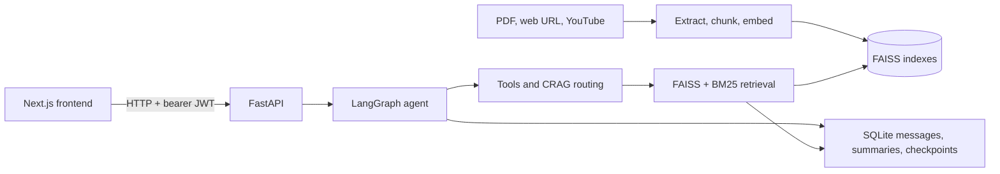

# NexusAI — LangGraph RAG Chatbot

NexusAI is a full-stack conversational assistant. A Next.js frontend talks to a FastAPI backend, where a LangGraph agent can answer directly, retrieve information from sources attached to a chat, use tools, or ask before searching the web.

## Features

- Email signup and verification, login, JWT authentication, and password reset.
- Persistent chat threads, generated titles, message history, and summaries stored in SQLite.
- Upload PDFs, index article URLs, or index YouTube transcripts as thread sources.
- Select which attached sources are active for a question; preview PDFs, YouTube videos, and web sources in the workspace.
- FAISS vector search combined with BM25 keyword retrieval, reciprocal rank fusion, and balanced results across documents.
- CRAG relevance grading. When retrieved context is insufficient, the graph pauses for approval before performing a web search.
- LangGraph checkpointing and resumable human approval, plus rolling conversation summaries and hybrid retrieval of earlier messages.
- Tools for web search, arithmetic, stock quotes, and Python execution.
- Responsive chat and source workspace with a persisted light/dark theme preference.

## Architecture



The graph starts with the chat node. It can call tools, route document retrieval through a relevance grader, produce a grounded answer, request web-search approval, or answer that the attached sources lack the information. On completion, internal tool messages are removed from the visible conversation state and older turns can be summarized.

## Project layout

```text
app/
  api/       FastAPI chat, thread, and source endpoints
  auth/      Signup, login, JWT checks, verification, password reset
  core/      Source processing, chunking, vector stores, retrieval
  graph/     LangGraph nodes, routing, CRAG, and HITL
  llm/       Model and embedding provider configuration
  memory/    SQLite persistence, summaries, historical retrieval, settings
  prompts/   Chat, RAG, and memory prompts
  services/  PDF, web, YouTube, and email services
  tools/     RAG, web search, calculator, stock, and Python tools
frontend/
  src/app/         Next.js pages and chat workspace
  src/components/  Chat, source management, viewers, and UI components
  src/lib/         API client and auth state
database/          SQLite database and backups
data/              Uploaded files and FAISS indexes
tests/             Python unit and integration tests
main.py            Root FastAPI application
requirements.txt   Python dependencies
```

Runtime data in `database/`, `data/`, and `logs/` is created or updated as the application runs.

## Requirements

- Python 3.10 or newer.
- Node.js and npm compatible with the installed Next.js 14 frontend.
- A configured LLM provider. The code tries Gemini first, then Ollama; OpenAI support exists in the provider configuration but is disabled by default.
- Ollama with the configured chat and embedding models if using the local fallback (`qwen2.5:3b` and `nomic-embed-text`).
- Optional service keys for Tavily web search and Alpha Vantage stock quotes.

## Setup

### Backend

From the repository root, create and activate a virtual environment, then install Python dependencies:

```bash
python -m venv .venv
# Windows PowerShell
.\.venv\Scripts\Activate.ps1
# macOS/Linux
source .venv/bin/activate
pip install -r requirements.txt
```

Create a root `.env` file. At minimum, set a strong JWT signing key and the API key for the LLM provider you plan to use:

```env
JWT_SECRET_KEY=replace-with-a-long-random-secret
JWT_ALGORITHM=HS256
ACCESS_TOKEN_EXPIRE_MINUTES=30
Gemini_API_Key=your-gemini-api-key
TAVILY_API_KEY=your-tavily-api-key
ALPHA_VANTAGE_API_KEY=your-alpha-vantage-api-key
```

`TAVILY_API_KEY` and `ALPHA_VANTAGE_API_KEY` are only needed for those tools. The Gemini key is read as `Gemini_API_Key` by the current code. Without it, the LLM and embedding configuration falls back to Ollama, which must be running locally with its models available. SMTP delivery is configured in `app/auth/email_service.py`.

### Frontend

```bash
cd frontend
npm install
```

Optionally set `NEXT_PUBLIC_API_BASE_URL` in `frontend/.env.local` if the backend is not at `http://127.0.0.1:8000`:

```env
NEXT_PUBLIC_API_BASE_URL=http://127.0.0.1:8000
```

## Run locally

Start the backend from the repository root:

```bash
uvicorn main:app --reload --host 127.0.0.1 --port 8000
```

The API documentation is available at `http://127.0.0.1:8000/docs`.

In a second terminal, start the frontend:

```bash
cd frontend
npm run dev
```

Open `http://localhost:3000`. The frontend redirects unauthenticated users to the login page. New accounts must be verified before login.

## API overview

Chat and thread endpoints require a bearer token unless noted otherwise.

| Method | Endpoint | Purpose |
| --- | --- | --- |
| `POST` | `/auth/signup` | Create an account and send a verification email. |
| `GET` | `/auth/verify-email?token=...` | Verify an account. |
| `POST` | `/auth/login` | Authenticate and receive a JWT. |
| `GET` | `/auth/me` | Get the current user profile. |
| `POST` | `/auth/forgot-password` | Request a password reset email. |
| `POST` | `/auth/reset-password` | Reset a password using its token. |
| `GET` | `/threads` | List the current user's threads. |
| `POST` | `/new-thread` | Create a thread. |
| `GET` | `/thread/{thread_id}/details` | Read thread messages, summary, and attached sources. |
| `POST` | `/chat` | Send a message; may return `completed` or `human-approval`. |
| `POST` | `/chat/resume` | Resume an interrupted turn with `yes` or `no`. |
| `POST` | `/generate-title` | Generate a thread title from a message. |
| `POST` | `/upload-pdf` | Upload and index a PDF for a thread. |
| `POST` | `/upload-url` | Fetch and index a web page for a thread. |
| `POST` | `/set_youtube` | Fetch and index a YouTube transcript for a thread. |
| `GET` | `/thread/{thread_id}/documents` | List sources attached to a thread. |
| `GET` | `/get_pdf/{thread_id}/{doc_id}` | Return an attached PDF for preview or download. |

The chat request accepts `thread_id`, `message`, optional `client_message_id`, and optional `selected_doc_ids`. The client message ID supports idempotent retries. Source upload endpoints verify that the authenticated user owns the target thread.

## Configuration options

Memory and retrieval settings can be supplied as environment variables; invalid values fall back to defaults.

| Variable | Default | Purpose |
| --- | --- | --- |
| `MEMORY_RECENT_MESSAGE_WINDOW` | `6` | Recent graph messages retained after summarization. |
| `MEMORY_MAX_MESSAGES_BEFORE_SUMMARY` | `12` | Message-count threshold that triggers summarization. |
| `MEMORY_HISTORICAL_RETRIEVAL_ENABLED` | `true` | Enable historical conversation search. |
| `MEMORY_HISTORICAL_TOP_K` | `5` | Historical messages injected into context. |
| `MEMORY_HISTORICAL_CANDIDATE_LIMIT` | `100` | Older messages considered for ranking. |
| `MEMORY_HISTORICAL_RRF_K` | `60` | Reciprocal rank fusion constant. |
| `RAG_CHUNK_SIZE` | `1000` | Target source chunk size. |
| `RAG_CHUNK_OVERLAP` | `200` | Chunk overlap. |
| `RAG_TOP_K` | `6` | Maximum retrieved chunks passed to the RAG tool. |
| `RAG_MIN_SCORE` | `0.0` | Minimum configured retrieval score. |
| `RAG_RERANKING_ENABLED` | `false` | Optional reranking setting. |

## Tests

Python tests are in `tests/` and use `unittest`. Run them from the repository root with:

```bash
python -m unittest discover -s tests
```

The frontend `package.json` also defines `npm test` and an E2E integration script is present at `frontend/scripts/e2e_integration_test.js`.

